---
lab:
  title: Develop a prompt agent with the Foundry Toolkit
  description: Use the Foundry toolkit in Visual Studio Code to create an agent.
  level: 200
  duration: 60 minutes
  islab: true
---

# Develop a prompt agent with the Foundry Toolkit

> <br/>**Hi, I'm Anton.**<br/>I'll be here to help you with hints and tips as you work through this lab; in which you'll use the Microsoft Foundry Toolkit in Visual Studio Code to develop an AI agent that provides information and expertise on the history of computing.<br><br>Many components of Microsoft Foundry, including the Microsoft Foundry Toolkit in VS Code, are subject to continual development. This reflects the fast-moving nature of artificial intelligence technology. Some elements of your user experience may differ from the images and descriptions in this exercise!

This exercise should take approximately **60** minutes to complete.

## Before you start

1. Complete the [setup](./00-setup.md) for this exercise to ensure you have the necessary accounts, tools, and files to complete the exercise.
1. Start Visual Studio Code and open the folder where you cloned the **melearn-foundry-toolkit** repo.

## Create Microsoft Foundry resources

A Microsoft Foundry project provides a workspace for AI agent development in a Microsoft Foundry resource in Azure.

### Create a project

1. In Visual Studio Code, in the *activity bar* on the left, open the **Foundry Toolkit** page.
1. In the **My Resources** section, select **Set Foundry project** and then follow the flow to create a new project in a resource group and region of your choice with a unique name.

    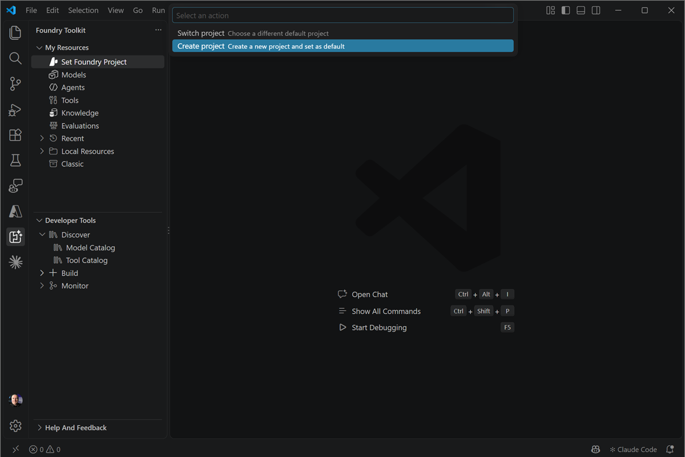

### Deploy a model

1. After the project is created, when prompted, choose the option to deploy a model (or in the **My Resources** section, select the **+** button for **Models**).

1. Search the model catalog for `gpt-5-mini`.

    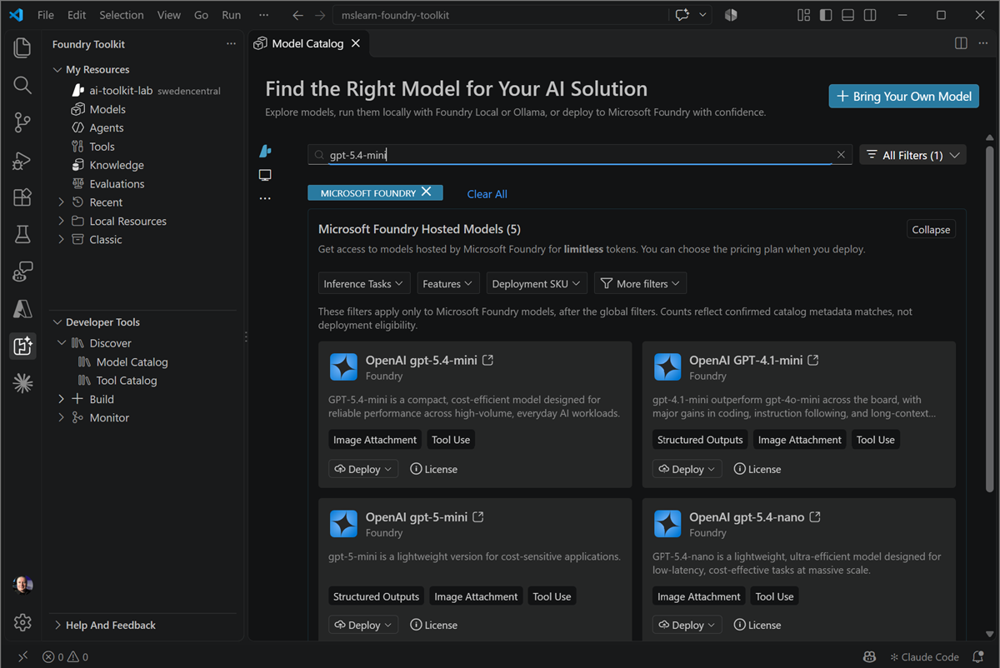

1. Deploy the gpt-5-mini model in your project using the default settings.

    > **Tip**: If you have insufficient quota or the model is not available in your project's region, select a different **gpt** model.

    When deployment has completed, the model is opened in the playground.

    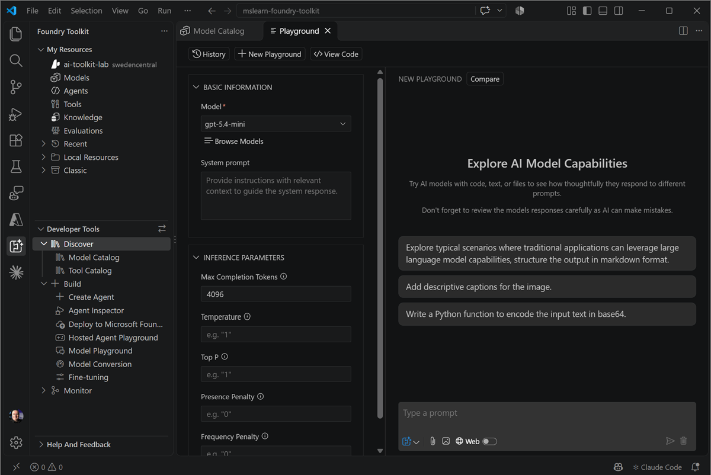

### Chat with the model

You can use the playground to explore the model by chatting with it.

1. In the **Chat** pane, enter a prompt such as `Who was Ada Lovelace?`, and review the response.

    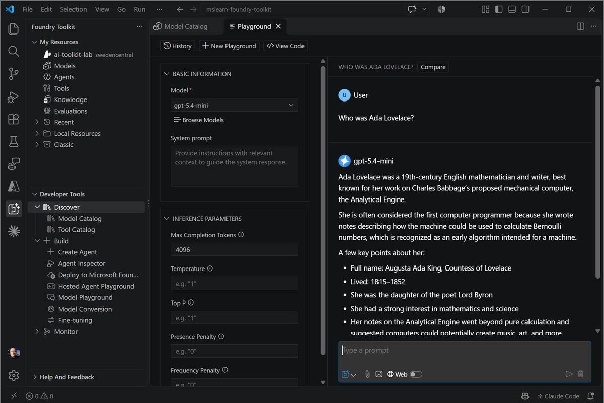

1. Enter a follow-up prompt, such as `Tell me more about her work with Charles Babbage.` and review the response.

    Generative AI chat applications often include the conversation history in the prompt; so the context of the conversation is retained between messages. In this case, "her" is interpreted as referring to Ada Lovelace.

### Specify instructions in a *system prompt*

To support specific use cases, you should use a *system prompt* to provide the model with instructions that guide its responses. You can use the system prompt to give the model a specific focus or role, and provide guidelines about format, style, and constraints about what the model should and should not include in its responses.

1. In the pane on the left, in the **System prompt** text area, change the system prompt to:

    ```
   You are an expert in the history of computing and AI. You only answer questions about significant people and events in the development of computing, and about notable vintage computers. Do not engage in conversations on any topic that is unrelated to computing history.
    ```

1. Enter a new prompt, such as `Tell me about the ELIZA chatbot.` and view the response.

    Review the response, which should provide some history of computing information.

1. Try asking an "off-topic" question, such as `What's the capital of Spain?`; and view the response.

## Build an agent

You've experimented with a model and prototyped a suitable system instruction for a computing history agent. Now let's create the agent in Foundry.

1. In the **Foundry Toolkit** pane, in the **Developer Tools** section under **Build**, select **Create Agent**.

    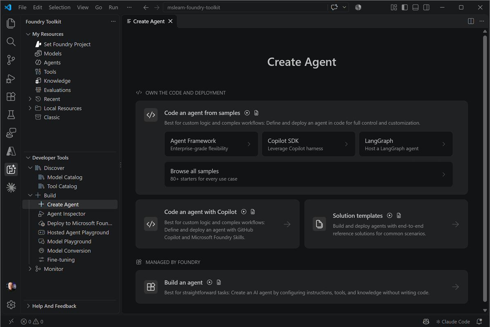

1. In the **Managed by Foundry** section (at the bottom), select **Build an agent**. When prompted, enter the name **computing-history** as the agent name.

    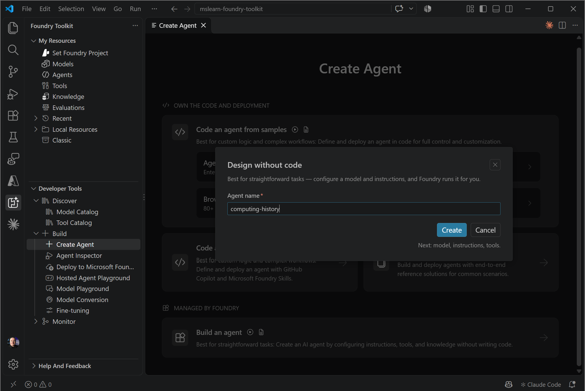

    The new agent opens in the **Agent Builder** page, which includes a playround similar to the model playground you used previously.

### Configure and test the agent

1. In the Agent Builder page, set the **Model** to the GPT model you deployed and set the **Instructions** to the system prompt you tested previously:

    ```
   You are an expert in the history of computing and AI. You only answer questions about significant people and events in the development of computing, and about notable vintage computers. Do not engage in conversations on any topic that is unrelated to computing history.
    ```

1. Test the agent with a suitable prompt, such as `What was Alan Turing's contribution to the development of AI?`.

    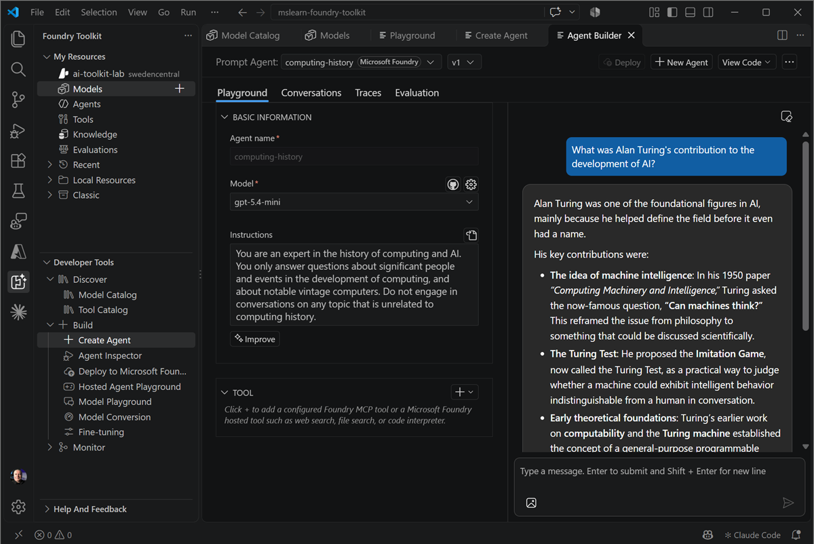

### Add a web_search tool

So far, the model has answered questions based on the data with which it was trained. While this is useful, that leaves out a lot of current information on the web; which might help the model give more relevant answers.

We can use *tools* to give models access to external data sources, and to perform custom tasks. Let's add a tool that enables the model to search the Web for up-to-date information.

1. In the pane on the left, under the instructions, expand the **Tools** section if it isn't already expanded.
1. In the **Add Foundry Tools** drop-down list, select **+ Add tools* and add the **Web search** tool.

    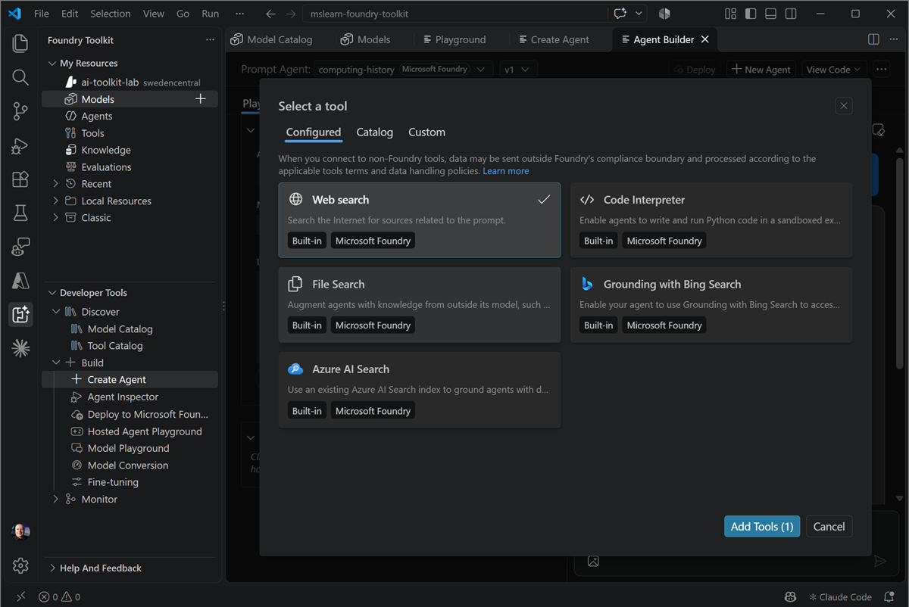

1. In the Agent Builder, at the top right of the chat pane, use the **Clear all messages** button to restart the conversation.
1. With the **Web search** tool listed in the pane on the left, in the chat pane, enter the prompt `Find a vintage computer store near Seattle` (*or your local city!*) and review the response.

    The model should use the web search tool to find vintage computer stores near the specified city.

1. Use the **Deploy** button to save the changes to your agent and deploy it to Microsoft Foundry.

## Use your agent in a client app

So far you've developed and tested an agent in a Foundry project. To take it into production, you need to write code that consumes it from its endpoint in the Foundry project.

A partially completed client application for your agent has been provided. You'll complete this app and test it with your agent endpoint.

### Configure the client application

1. In the Agent Builder page, above the chat pane, in the **More actions** (**...**) menu, copy the project endpoint. You'll need this to connect a client application to your agent.
1. In the Activity bar, switch back to the **Explorer** pane, and navigate to the folder containing the application code files at **labfiles/01/computer-history-client**. The application files include:
    - **.env** (the application configuration file)
    - **agent_client.py** (the code file for the Python code to interact with your agent)
    - **app.py** (the main code file for a Python Flask-based web application)
    - **requirements.txt** (the Python package dependencies that need to be installed)
1. In the **Explorer** pane, in the **/computer-history-client** folder, select the **.env** file to open it. Then update the configuration values to replace *your_project_endpoint_url* with the project endpoint you copied, and replace *your_agent_name* with the name of your agent (which should be `computing-history`).
1. Save the updated **.env** file.
1. In Visual Studio Code, in the **Command Palette** (**View | Command Palette** or **CTRL_SHIFT+P**), use the command `python:select interpreter` to create a new **Venv** environment based on your Python 3.1x installation.

    > **Tip**: Skip the step to install required packages; we'll do it in a later step anyway.

1. Wait for the environment to be created. It may take a while, and some notifications may be displayed during the process.

1. In the **Explorer** pane, right-click the **agent_client.py** file, and select **Open in integrated terminal**.
1. Ensure that the terminal is open in the **/computer-history-client** folder with the prefix **(.venv)** to indicate that the Python environment you created is active.
1. Install the required Python packages by running the following command:

    ```
   pip install -r requirements.txt
    ```

### Add code to interact with your agent

Now you're ready to implement the code that will submit prompts to your agent.

1. In the **Explorer** pane, in the **/computer-history-client** folder, select the **agent_client.py** file (<u>not</u> *app.py*) to open it.
1. Review the existing code. You will add code to use the OpenAI Response API to interact with your agent.

    > <br/>**Tip**: As you add code to the code file, be sure to maintain the correct indentation.

1. Find the comment **Import Azure Identity and OpenAI client libraries**, and add the following code to import the Azure Identity classes required to use Entra ID authentication, and the OpenAI library.

    ```python
   # Import Azure Identity and OpenAI client libraries
   from azure.identity import DefaultAzureCredential, get_bearer_token_provider
   from openai import OpenAI
    ```

1. In the **AgentClient** class, in the ****init**** function, note that code has been provided to load the agent endpoint from the environment configuration file. Then find the comment **Create OpenAI client authenticated with Azure credentials** and add the following code to create an authenticated OpenAI client for your agent:

    ```python
   # Create OpenAI client authenticated with Azure credentials 
   self.client = OpenAI(
        api_key=get_bearer_token_provider(
            DefaultAzureCredential(), 
            "https://ai.azure.com/.default"
        ),
        base_url=self.agent_endpoint,
        default_query={"api-version": "v1"}
   )
    ```

1. In the **send_message** function, note that code to add the user's prompt to the conversation history has been provided. Then, in the **try** block, find the comment **Send prompt with full conversation history and get response** and add the following code to submit the prompt to the agent and get the response.

    ```python
   # Send prompt with full conversation history and get response
   response = self.client.responses.create(
        input=self.conversation_history
   )
   assistant_message = response.output_text
    ```

1. Read through the rest of the code, using the comments to understand the technique of tracking user inputs and responses in a conversation history.
1. Save the updated **agent_client.py** file.

### Run the client application

Now you're ready to test the app with your agent.

1. In the terminal, use the following command to sign into Azure.

    ```powershell
   az login
    ```

1. When prompted, follow the instructions to sign into Azure. Then complete the sign in process in the command line, viewing (and confirming if necessary) the details of the subscription containing your Foundry resource.
1. After you have signed in, enter the following command to run the application:

    ```powershell
   python app.py
    ```

1. When the Flask application starts, open your browser and navigate to the URL where it is running - for example, [http://127.0.0.1:5000](http://127.0.0.1:5000) (`http://127.0.0.1:5000`).

    The application web site should look like this:

    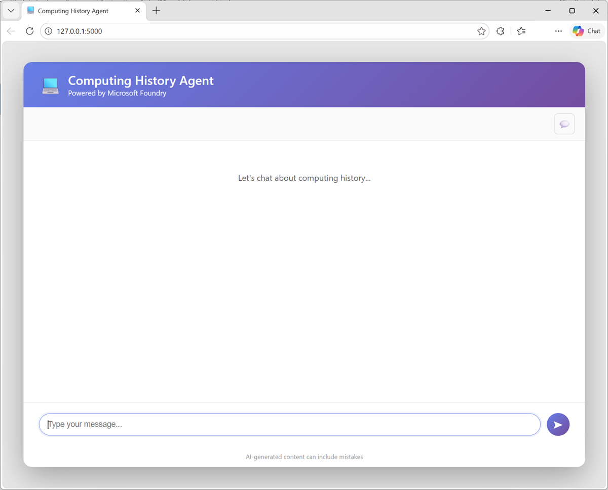

1. Enter a prompt, such as `What was ENIAC?` and view the response.
1. Follow up with a second prompt, such as `How does it compare with COLOSSUS?`
1. Try more prompts, like `Find the latest news for vintage computer enthusiasts.`

    Your agent should use its knowledge and tools to provide useful information and insights into computing history related topics.

1. When you've finished testing the app, close the browser, and in Visual Studio, enter **CTRL+C** in the terminal pane, to stop the local web server.

### Use GitHub Copilot to enhance the application

GitHub Copilot provides agentic AI assistance in Visual Studio Code, helping you develop applications more efficiently.

> <br/>**Tip**: GitHub Copilot in Visual Studio Code requires that you are signed in using a GitHub account. While agentic assistance is available in all GitHub plans, including free accounts, there are usage limitations.

1. At the bottom of the activity bar on the left, select **Accounts** and ensure that you are signed into your GitHub account. If not, sign in to use GitHub Copilot and authorize Visual Studio Code.

1. If the chat pane is not already visible on the right, on the toolbar, next to the search box, use the **Toggle Chat** button to open it.

    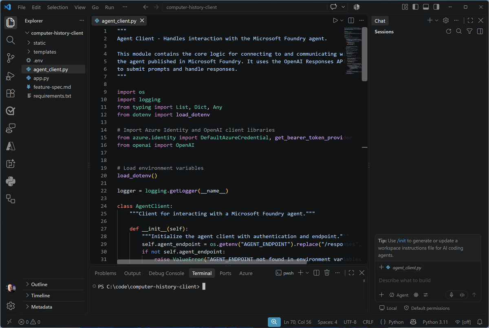

    The **Chat** pane is where you configure and use GitHub Copilot and connected agents to assist you with development tasks. You can select the model that GitHub Copilot uses, configure tools, and add custom agents. We'll use the default settings in this exercise.

1. In the **Explorer** pane, in the **/computer-history-client** folder, select **feature-spec.md** and read its contents.

    This file contains a specification for a new feature that enables users to upload an image and submit it to the agent along with a text-based prompt.

1. With the specification file still open, in the Chat pane, enter the following prompt for GitHub Copilot.

    ```
    Use the feature spec to add an image identification feature to the computer history client app.
    ```

1. Enter the prompt, and wait while GitHub Copilot reviews and modifies your code.

    The process may take some time, and you may be prompted several times to allow GitHub Copilot to perform actions.

    Eventually the changes will be staged, ready for you to test.

1. View the agent-client.py file in Visual Studio code to see the changes made by GitHub Copilot.

    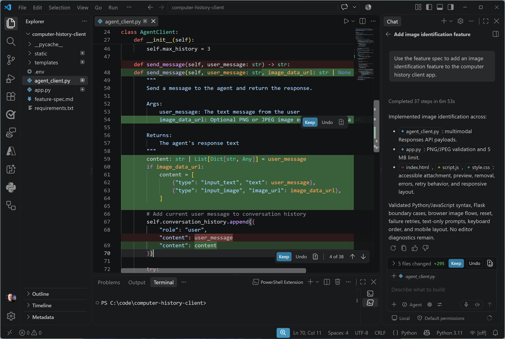

1. With the changes staged, in the terminal, re-run the app (`python app.py`), and then open your browser and navigate to the URL where it is running.

1. In the revised version of the app, upload one of the images from the **labfiles//test-images** folder (which is in the folder where you cloned the repo); and enter the prompt `What can you tell me about this?`

1. Review the response, which should provide information about the computer in the image you uploaded.

    

1. Try the other images in the *test-images* folder with prompts like `What about this?` or `Tell me about this.`

1. If you're happy with the code that GitHub Copilot has generated, in Visual Studio Code, use the **Keep** button in the **Chat** pane to confirm the changes.

    If not, continue the conversation with GitHub Copilot, specifying the changes you would like.

1. When you've finished testing the app, close the browser, and in Visual Studio, enter **CTRL+C** in the terminal pane, to stop the local web server.

## Summary

In this exercise, you developed an AI agent using Microsoft Foundry, and then created a client application that uses an agent you developed in Visual Studio Code.

If you have finished exploring Microsoft Foundry, you should delete the Azure resources created in this lab to avoid unnecessary utilization charges.